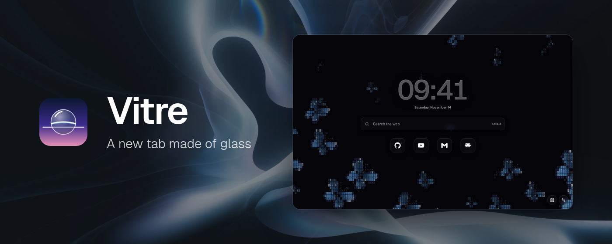
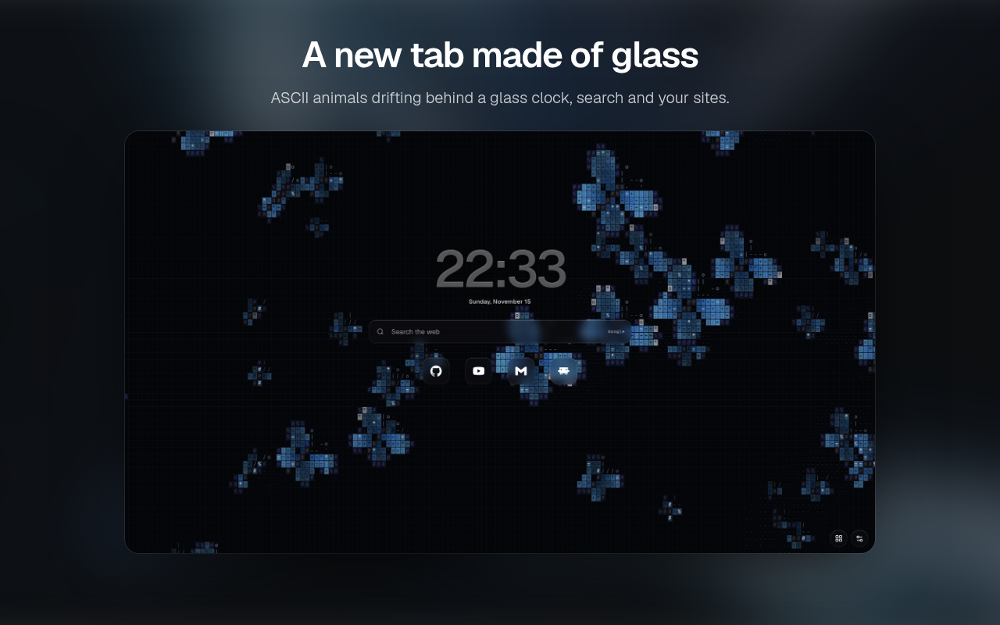
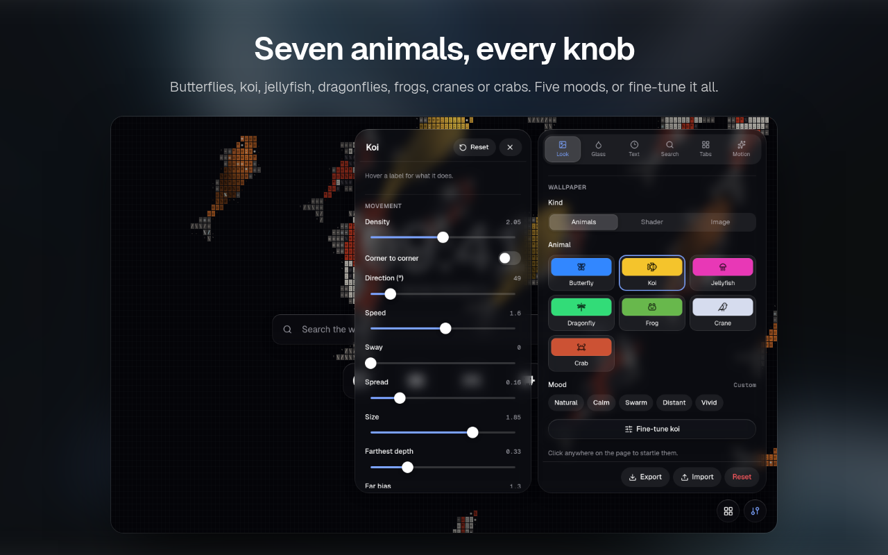

<p align="center">
  
</p>

<h1 align="center">Vitre</h1>

<p align="center">
  <b>A new tab made of glass.</b><br>
  ASCII animals, your pictures or a living gradient, behind a clock cut out of glass, search and your sites. Nothing else.
</p>

<p align="center">
  <a href="#install"></a>
  
  
</p>

<p align="center">
  
</p>

---

Every new tab is a moment you look at a hundred times a day. Vitre makes it a quiet pane of frosted glass over a flock of ASCII animals, a picture you love or a slow gradient: the background arrives with an iris, a plasma dissolve or a grid of tiles, then the clock, the search bar and your sites settle in on top, each one a piece of glass blurring what's behind it.

No feeds. No news. No account. No server. Just yours.



## ASCII animals



Let ASCII animals drift behind the glass, the default since 1.1: butterflies, koi, jellyfish, dragonflies, frogs, cranes or crabs. Each comes with five moods (natural, calm, swarm, distant, vivid) and a fine-tune panel with every knob, saved per animal. Click anywhere to startle them. Built on [ascii-animals](src/ascii/README.md) (MIT).

## Glass, everywhere


Every surface is real frosted glass: the search bar, your tabs, the panels, even the clock's digits, cut out of the glass itself. Frost, tint, saturation, rim light and roundness move live as you drag. It's plain CSS with nothing computed per frame, so it stays fast.

## Your sites, your icons


Favourite tabs as glass buttons, in as many columns as you like, labels on or off. Give each one its site's icon, a letter, any of **3,500 brand marks** (YouTube, Netflix, GitHub, Spotify…) or **1,600 icons**, all searchable. The list has its own panel: drag to reorder, and a new tab names itself after its site.

## Your pictures, or a living gradient


Drop in your own pictures: they're cached in the browser, so a new tab opens instantly, even offline. Show a new one on every tab, every few hours, or always the same. Or pick a slow mesh gradient in one of nine palettes and tune its motion, vibrance and luminosity. Blur, dim and grain on top of any of them, with two grain styles and a size from fine to coarse.

## Choose how it arrives

Eight reveals for the background (iris, grid, plasma, zoom out, wipe, blinds, fade, none) and seven entrances for the page, with the wait, duration and stagger you set. Every option has a live preview. A new tab opens on your last background's tone and waits until the picture is ready, so there's never a black flash. Reduced-motion settings are respected.

## Everything else

- **Search** with Google, Brave, DuckDuckGo, Kagi, Startpage or any URL with `%s`. Type an address to go straight there.
- **Clock** in glass digits or plain, any size and weight, 12 or 24 hours, seconds and date optional.
- **Welcome line** that greets you by the time of day (`{greeting}`), optionally on glass.
- **Theme** dark, light or system, an accent colour, three typefaces.
- **Export / import** your whole setup as one JSON file.

## Private by design

Settings and pictures stay in your browser. Nothing is collected, nothing is sent anywhere, with one exception you control: a tab set to show its site's icon loads it from Google's favicon service (pick a brand icon instead to avoid it). Full policy: [PRIVACY.md](PRIVACY.md).

## Install

**From source**

```sh
pnpm install
pnpm build          # → dist/
```

- **Brave / Chrome:** `brave://extensions` → Developer mode → *Load unpacked* → `dist/`
- **Firefox** (140 or later): `about:debugging#/runtime/this-firefox` → *Load Temporary Add-on* → `dist/manifest.json`

## Develop

```sh
pnpm dev            # the page on localhost:5173, settings in localStorage
pnpm test           # node --test
pnpm zip            # vitre-chrome-<v>.zip and vitre-firefox-<v>.zip
pnpm shots <url>    # regenerate the store images from a running dev server
pnpm release        # send the committed version to both stores (see Release)
```

Vite + React + TypeScript. The glass and every control are hand-written (`src/ui.tsx`, `src/styles.css`); the gradient is [Paper Shaders](https://github.com/paper-design/shaders), brand marks are [Simple Icons](https://simpleicons.org) (CC0), icons are [Lucide](https://lucide.dev). Store listing and images live in [`store/`](store/LISTING.md).

## Release

Bump `version` in `public/manifest.json` and `package.json`, commit, then:

```sh
pnpm release            # both stores
pnpm release firefox    # or one of them
pnpm release chrome
```

It builds both zips and checks the tree is committed. It then sends Firefox the package, the source (`git archive` of the commit, which Mozilla rebuilds to review the bundle) and the listing generated from [`store/LISTING.md`](store/LISTING.md), and uploads and publishes the Chrome zip. Both stores review each version before it goes live. Keys go in `.env.store` (git-ignored, template in `.env.store.example`).

One-time setup:

- **Firefox:** sign in on [addons.mozilla.org](https://addons.mozilla.org/developers/), accept the developer agreement, then generate API credentials under [Manage API keys](https://addons.mozilla.org/developers/addon/api/key/) (`WEB_EXT_API_KEY`, `WEB_EXT_API_SECRET`). The first `pnpm release firefox` creates the listing, so there's no manual upload. Add the screenshots from `store/` on the listing page afterwards.
- **Chrome:** the API can't create an item, so upload the first zip by hand in the [Developer Dashboard](https://chrome.google.com/webstore/devconsole). Then, in a Google Cloud project, enable the *Chrome Web Store API*, create an OAuth client (type *Desktop app*) and get a refresh token for it ([guide](https://github.com/fregante/chrome-webstore-upload-keys)). Fill in `EXTENSION_ID` (from the item's dashboard URL), `PUBLISHER_ID` (Dashboard → Account), `CLIENT_ID`, `CLIENT_SECRET` and `REFRESH_TOKEN`.

## License

MIT © Tim Lacault
